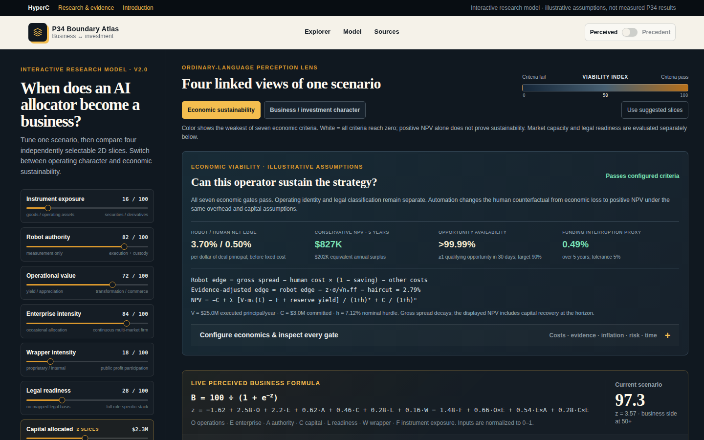
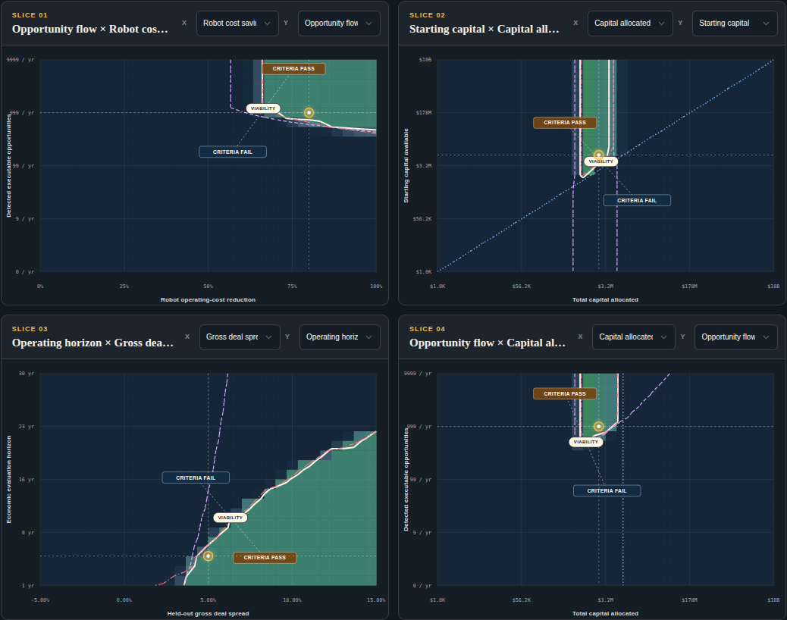
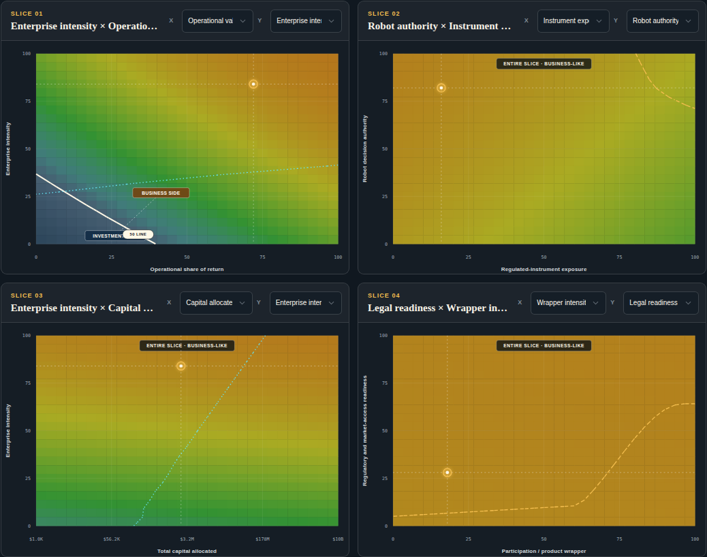
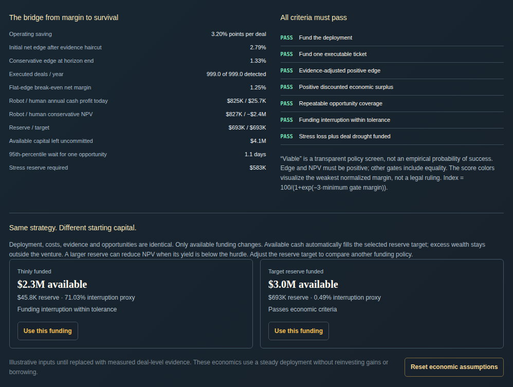
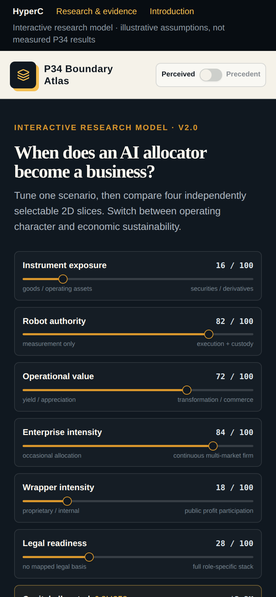

# Business–Investment Boundary Atlas

**When does an AI robot become a business?** This interactive research model from [HyperC](https://hyperc.com) shows when an AI-operated strategy looks like an operating business, whether its edge survives costs and uncertainty, and how much capital it needs to keep going.

### ▶ Live: **[hyperc.com/research/business-investment-atlas/](https://hyperc.com/research/business-investment-atlas/)**

Introduction: [*When does an AI robot become a business?*](https://hyperc.com/blog/when-does-a-robot-become-a-business.html) · Also listed on [HyperC Research & evidence](https://hyperc.com/research.html#interactive-model)



> **Illustrative theory explorer.** Default values and precedent weights are illustrative. They are not fitted to a legal-case dataset or to live deal data, and the outputs are not measured P34 performance, a forecast of returns, or a legal, tax or investment determination.

## What it does

You set up one scenario and look at it through **four linked two-dimensional slices**. Each slice has its own X and Y axis, picked from twelve coordinates:

| Structural | Economic |
| --- | --- |
| Instrument exposure · robot authority · operational value · enterprise intensity · wrapper intensity · legal readiness | Allocated capital · available starting capital · robot cost saving · gross deal spread · opportunity flow · horizon |

Every slice shades its surface, draws the boundary, and labels which side of the boundary means what. Two layers answer separate questions:

- **Economic sustainability** has 19 configurable assumptions. It compares the robot with a human counterfactual, applies an evidence haircut for small or noisy validation samples, and discounts NPV against a nominal hurdle, with inflation applied only once. It also models edge decay, opportunity droughts, reserve stress and a funding-interruption proxy. The result is seven explicit pass/fail gates.
- **Business / investment character** offers two lenses, *perceived* and *precedent-informed*. Both are transparent heuristic classifiers whose coefficients and threshold you can edit.

A **constrained solver** suggests moves or deployment sizes. It holds starting wealth, measured edge and opportunity flow fixed, so it can't fix an underfunded scenario by assuming more money or better predictions. Formulas, methodology and research citations appear on the page itself.

## Screenshots

**Economic layer.** Shaded regions pass or fail the configured criteria, with the viability boundary and the current scenario marked:



**Business / investment character layer**, using the suggested slices:



**Every gate shown.** The bridge from margin to survival, all seven criteria, and the same strategy with thin versus target funding:





**On a phone**, the slices stack and every control stays usable.

The four questions are kept apart on purpose:

1. **Operating character:** does this look like a business or an investment, under perceived or precedent-informed factors?
2. **Economic sustainability:** does the evidence-adjusted surplus, together with enough repeatable opportunities and enough funding, hold up for this operator over this horizon?
3. **Market capacity:** can the deployment fit inside the markets it can reach?
4. **Regulatory readiness:** does the assumed set of permissions meet the role's requirements?

A positive NPV, a large starting balance, or a high score does not by itself create a legal classification. More wealth improves funding capacity but does not create an edge.

<br clear="right">

## Run it locally

Requires Node.js ≥ 22.13 (tested with Node 24).

```sh
npm ci
npm test          # 13 numerical checks of the economic model
npm run dev       # http://127.0.0.1:5173/research/business-investment-atlas/
npm run build     # type-check + production build into dist/
npm run preview   # serve dist/ the way production does
```

The build uses `/research/business-investment-atlas/` as its base path. To serve it somewhere else, set an absolute path with a trailing slash:

```sh
ATLAS_BASE_PATH=/ npm run build
```

`dist/` is a fully static site. It needs no server, account, API key, database or CDN, and it bundles all scripts and styles. In production, hyperc.com serves this build unchanged as a static directory on GitHub Pages.

## Project layout

| Path | Contents |
| --- | --- |
| `app/p34-atlas.tsx` | State, controls, the linked SVG slices, contours, labels, solver presentation |
| `app/economic-workbench.tsx` | Economic controls, comparisons, formulas, methodology and citations |
| `app/model.ts` | Structural classifier, regulatory and market-capacity heuristics, axes, movement solver |
| `app/economics.ts` | Economic equations and default settings |
| `app/globals.css` | Page styling (Tailwind v4 theme) |
| `components/ui/`, `lib/` | Select, slider, switch and tooltip primitives (Radix) |
| `tests/economics.test.mjs` | The model checks |
| [`docs/MODEL.md`](docs/MODEL.md) | Equations, units, constraints, assumptions and limitations |
| [`docs/RESEARCH_SOURCES.md`](docs/RESEARCH_SOURCES.md) | Primary references and how each one informed the model |

## Model checks

`npm test` runs these checks on every push (see [CI](.github/workflows/ci.yml)):

1. Closed-form NPV matches independent annual discounted cash flows, including zero hurdle, decay and deflation.
2. Inflation is applied exactly once, and higher inflation lowers NPV.
3. The default robot creates economic surplus while the human counterfactual loses value.
4. A poorer operator loses resilience at the same deployment, and excess wealth saturates.
5. Starting wealth alone cannot manufacture a positive edge.
6. Zero opportunity flow, or a deployment below one ticket, fails even with wealth.
7. Fewer independent observations lower the evidence-adjusted margin.
8. A zero edge with no costs or risk does not count as viable.
9. The funding first-passage approximation matches the known drift-free case and deterministic paths.
10. Long settlement cannot be financed by optimistic smooth deal income.
11. Shared economics carry through both character lenses without changing legal identity.
12. The solver preserves wealth and evidence, rejects underfunded moves, and its economic candidates pass every gate.
13. Score, NPV and risk stay finite across the full coordinate grid and setting extremes.

With default assumptions, the robot's initial net edge is 3.70% per deal against 0.50% for the human counterfactual. The conservative five-year NPV is about **+$826,700**, against about −$2.44M for the human. These numbers are a reproducibility fixture, not a forecast.

## Credits

Concept and model: Andrew Gree / [HyperC](https://hyperc.com). Third-party notices: [`vendor/shadcn-tailwind-4.13.0.LICENSE.md`](vendor/shadcn-tailwind-4.13.0.LICENSE.md).
